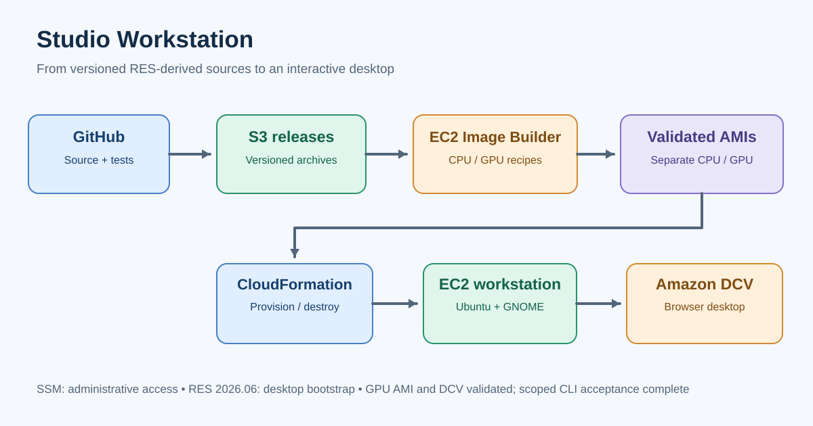

# Studio Workstation

A standalone AWS Ubuntu 24.04 workstation using **EC2**, **CloudFormation**, **Amazon DCV**, **Systems Manager**, and the adapted **AWS Research and Engineering Studio (RES) 2026.06** bootstrap. CPU and GPU workstation images are separate; the full RES control plane is not required.



## Status after merged PR #65

| Capability | Verified outcome |
|---|---|
| CPU desktop | Ubuntu 24.04 + DCV, local login and stop/start tested |
| CPU Image Builder | Staged CPU GDM-first recipe 0.5.0 validated |
| GPU AMI | Image Builder recipe 0.1.11/1 validated; AMI `ami-027c98f85b155c2ac` in `us-east-1` |
| GPU desktop | Tesla T4, hardware-accelerated OpenGL 4.6, Xorg, GDM, RES bootstrap and real DCV login verified |
| GPU CLI lifecycle | **Live create, user DCV login, stop/start, saved-file checksum persistence, and test-resource cleanup passed** in [Issue #46](https://github.com/vision-kwest/studio-workstation/issues/46) |
| PR #65 | **Merged into `main`** |
| GPU Image Builder pipeline | Still disabled and pointing to older recipe 0.1.10; successful 0.1.11/1 image was built separately |
| Production access/security | Trusted public TLS and secure access from changing networks remain separate hardening work ([Issue #62](https://github.com/vision-kwest/studio-workstation/issues/62)) |

**Important distinction:** Successful one-off GPU CLI acceptance does **not** make this a general-purpose, unlimited GPU launcher. The current code restricts GPU creation to the previously approved `studio-gpu-cli-accept65` stack and its exact cleanup token, and a dedicated IAM role authorizes expiration for that same scope. The test resources were deleted afterward; the role remains. See [GPU-specific requirements and limitations](docs/studio-cli.md#gpu-workstation-tested-acceptance-scope).

## Quick start

Run from AWS CloudShell in the authorized account and `us-east-1`:

```bash
git clone https://github.com/vision-kwest/studio-workstation.git
cd studio-workstation
python3 -m pip install -r requirements.txt
python3 studio workstation --help
```

The repository command is **`python3 studio workstation ...`**; `studio` is a local Python entry point, not a separately installed executable. You also need AWS CLI v2, AWS permissions, and the existing AMI, release bucket, VPC/subnet and workstation instance profile.

**Preview a CPU workstation without deploying anything:**

```bash
python3 studio workstation create \
  --stack studio-workstation-cpu-review \
  --profile cpu --dry-run
```

**Create a CPU workstation** (billable; select a trusted DCV client IP):

```bash
python3 studio workstation create \
  --stack studio-workstation-cpu-review \
  --profile cpu --client-cidr YOUR_PUBLIC_IP/32
```

**GPU acceptance example:** The validated GPU path is intentionally limited to the exact acceptance scope and time-bounded expiration policy. Do **not** reuse the old example as a general production launch recipe. See [Studio CLI — GPU workstation](docs/studio-cli.md#gpu-workstation-tested-acceptance-scope) for the approved parameters, account-specific assumptions, costs, and cleanup responsibilities.

To inspect, connect, or stop an existing stack:

```bash
python3 studio workstation status --stack STACK_NAME
python3 studio workstation connect --stack STACK_NAME
python3 studio workstation stop --stack STACK_NAME
python3 studio workstation start --stack STACK_NAME
```

The CLI **does not require** `--yes`, `--confirm-stack`, or `--confirm-instance`. `create` performs the action unless `--dry-run` is specified. For final teardown, `destroy --stack STACK_NAME --delete-stack` deletes stack-managed resources, **not necessarily retained EBS volumes or test Scheduler schedules**. Follow [the cleanup checklist](docs/studio-cli.md#destroy-and-verify-cleanup).

After provisioning, set a unique local `workstation` password interactively via SSM (`sudo passwd workstation`); DCV uses **Linux system credentials**, not AWS console credentials. Login through the DCV URL printed by `connect`.

## Optional trusted DCV TLS — Issue #43 (DRAFT; not deployed)

The simplified design uses a dedicated Elastic IP, a single Route 53 A record,
one exportable AWS ACM public certificate, and AWS Workload Credentials Provider
(v3.1.2) to refresh trusted TLS on the workstation. A minimal, offline-tested
DCV activation hook validates and switches a versioned certificate/key pair.
**No Elastic IP, A record, ACM certificate, IAM change, or agent installation
has been authorized or deployed.** The working IP-based connection and
self-signed certificate remain unchanged.

See [Issue #43 simplified ACM/DCV runbook](docs/issue43-acm-dcv.md).
Draft [PR #67](https://github.com/vision-kwest/studio-workstation/pull/67)
is deliberately unmerged. The former Lambda/DDNS/Certbot proposal is retired.

## Security and operating costs

- No inbound SSH is needed. Use Systems Manager for maintenance and Amazon DCV for the graphical desktop.
- The CPU CLI's historical default is public TCP 8443 (`0.0.0.0/0`); **supply `--client-cidr` to restrict it**. In the scoped GPU CLI, public DCV is permitted only with explicit `--allow-public-dcv`. Public exposure is **not** a private network; prefer a trusted CIDR or future identity-aware private access for long-lived deployments.
- Treat the self-signed DCV TLS certificate as untrusted until you verify its fingerprint or install a trusted certificate. Use a strong, unique local password. Do not put passwords, private keys, tokens or NVIDIA driver binaries in the repository or CloudFormation user data.
- Stopping an instance stops running-instance compute charges, **not EBS charges**. Starting the same instance can give it a new public IP. Retained GPU root EBS volumes use `DeleteOnTermination=false`.
- The tested GPU acceptance schedules were one-time safeguards (instance termination and a subsequent **best-effort** EBS deletion attempt), not a reusable production lifecycle service. The completed acceptance test's instance, volume, SG, launch template and schedules were verified removed; the scoped expiration IAM role remains.
- The GPU source AMI snapshot is unencrypted; the validated GPU test launched with an explicitly encrypted root EBS volume. Re-evaluate AMI/snapshot encryption before wider use.

## Documentation and historical reports

Start with the [documentation index](docs/INDEX.md), [Studio CLI / daily operations](docs/studio-cli.md), [GPU profile](docs/gpu-workstation-profile.md), [runtime/release provenance](runtime/README.md), and [lifecycle diagram](docs/workstation-lifecycle-visual.md). Earlier Gate 1–4, Image Builder and PR #65 preflight documents preserve historical observations rather than today's deployment instructions.

The original RES runtime sources remain pinned to [`aws/res` tag `2026.06`](https://github.com/aws/res/tree/2026.06); see [compatibility evidence](docs/RES_COMPATIBILITY.md) and [deviation register](docs/DEVIATIONS.md).
