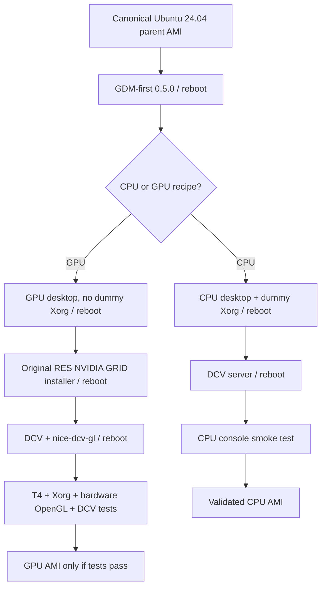

# CPU and GPU image building — visual guide

The **CPU Image Builder pipeline** is our proven reference. The **GPU pipeline** follows its staged GDM-first/reboot pattern, with the original RES NVIDIA GRID path.

## Inputs and outputs

| Input | Role |
|---|---|
| Parent Ubuntu AMI | OS baseline; a stale base triggered the intentional exit-40 package upgrade guard |
| Image recipe | Ordered, versioned Image Builder components |
| Infrastructure configuration | Temporary build instance type and instance profile |
| Distribution configuration | AMI naming and distribution region |
| RES installation archive | Original bootstrap, GPU driver installer and DCV integration |
| Pinned NVIDIA GRID dependency | Exact S3 object version and expected SHA-256 |

| Output | Meaning |
|---|---|
| Image Builder execution | Build and test status, component logs |
| Custom AMI | Created only after build stages complete |
| GPU workstation | Separate CloudFormation deployment and interactive DCV validation required |

## Status of the first GPU builds

- GPU 0.1.2/1 failed in `InstallDesktop` with intentional exit 40 (core OS package upgrade guard).
- GPU 0.1.3/1 was started with refreshed Canonical Ubuntu 24.04 AMI `ami-0d6dd9e8265d48906`. **Its outcome is not yet confirmed in this documentation.**
- No successful GPU AMI or GPU DCV login should be inferred from a pipeline's `BUILDING` state.

See [RES GPU source trace](res-gpu-imagebuilder-audit.md) and [GPU profile](gpu-workstation-profile.md).
