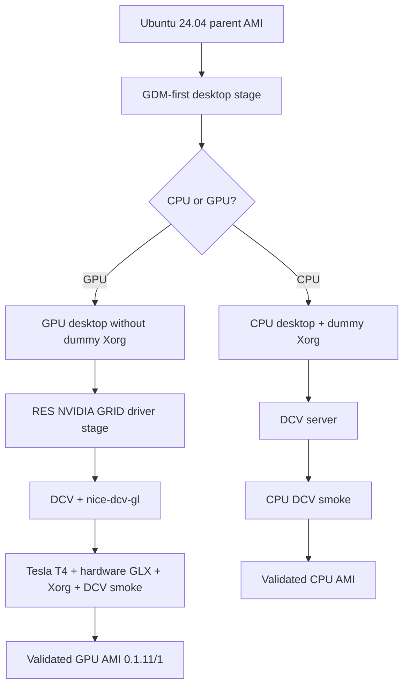

# CPU and GPU Image Builder — process and actual status

The **CPU** Image Builder recipe uses GDM-first desktop staging. The **GPU** recipe adds the RES NVIDIA GRID stage and hardware-accelerated OpenGL checks. Image building is not the same as operating a live EC2 desktop.

## Input / output boundaries

| Input | Role |
|---|---|
| Ubuntu parent AMI | OS baseline, package/upgrade/reboot compatibility |
| Image recipe/components | Versioned installation order and reboot checkpoints |
| Build IAM role | Pinned source package and NVIDIA driver reads |
| `g4dn.xlarge` builder | Actual Tesla T4 hardware smoke tests |
| RES source archives | Pinned RES 2026.06 installers and runtime |

| Output | Meaning |
|---|---|
| Successful Image Builder image | Recipe and configured smoke tests completed |
| Available AMI | Reusable image, **not** a running desktop |
| Interactive workstation | Separately tested CloudFormation + RES bootstrap + DCV login |

## GPU milestones

- Earlier GPU 0.1.2/1 and other builds failed during desktop/core package installation. The initial 0.1.3/1 outcome was unconfirmed in an older visual milestone; that was **not the final project state**.
- **0.1.11/1 succeeded**, producing GPU AMI `ami-027c98f85b155c2ac` in `us-east-1`.
- Live standalone RES/DCV/Tesla T4 login, persistent root-EBS stop/start and cleanup were subsequently verified through merged PR #65 ([Issue #46](https://github.com/vision-kwest/studio-workstation/issues/46)).
- The **GPU Image Builder pipeline remains disabled and references older recipe 0.1.10**. Updating it is independent of the working 0.1.11/1 AMI.

See [GPU profile](gpu-workstation-profile.md), [runtime provenance](../runtime/README.md), [original RES GPU audit](res-gpu-imagebuilder-audit.md) (historical) and [Studio CLI](studio-cli.md).
