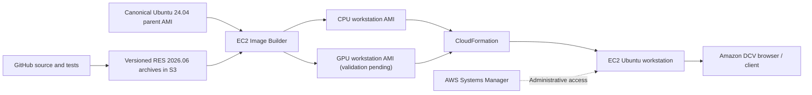

# Studio Workstation — visual architecture

The illustration separates **image creation** from **workstation operation**. An AMI is a reusable image; it is not a running desktop. The CPU path has been validated end-to-end, while the GPU path is still in Image Builder testing.

## Provisioning relationships

**Key distinction:** Image Builder creates an AMI using a temporary EC2 build instance. CloudFormation later launches a separate workstation instance from a validated AMI. The workstation downloads the published RES-derived runtime archive and initializes the console using the existing RES bootstrap.

## Trust and ownership boundaries

- GitHub contains source and validation tests; do not commit credentials or driver binaries.
- S3 holds release artifacts and separately versioned dependencies.
- Image Builder uses a build instance profile; the running workstation uses its own SSM role.
- DCV authenticates the local Linux `workstation` account, not AWS IAM credentials.
- The current DCV endpoint can use an untrusted TLS certificate; trusted hostname/certificate work is deferred.
- The existing public DCV ingress configuration should be reviewed before exposing sensitive data.

See [GPU image building](gpu-image-builder-visual.md) and [workstation lifecycle](workstation-lifecycle-visual.md).
