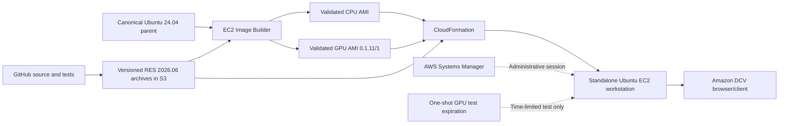

# Studio Workstation — architecture

Image creation and workstation operation are separate: Image Builder prepares a CPU or GPU AMI; the Studio CLI renders a RES-derived CloudFormation template and launches a distinct EC2 instance. **CPU and GPU AMIs and their DCV login paths have been validated; GPU CLI stop/start persistence passed in merged PR #65.**

## Provisioning relationships

The GPU AMI `ami-027c98f85b155c2ac` passed Image Builder 0.1.11/1, but its **Image Builder pipeline remains disabled and points to 0.1.10**. A successful manual image build does not imply the pipeline was upgraded. The runtime downloads separate version-pinned installer and application archives after launch.

## Trust and ownership boundaries

- GitHub stores source and tests, not passwords, private keys or proprietary NVIDIA binaries.
- The live EC2 uses `StudioWorkstationSSMRole` for SSM and exact-version RES S3 access; Image Builder has its own permissions.
- DCV authenticates the local Linux `workstation` user, **not AWS IAM**. A unique password is enrolled interactively through SSM.
- The one-off GPU CLI is restricted to an exact stack/token and uses a tag-conditioned Scheduler role, **not** the earlier proposed Lambda/DynamoDB cleanup framework.
- Public TCP 8443 may be explicitly enabled for access from changing networks; this is internet exposure, not identity-aware private networking. No inbound SSH. Trusted TLS and broader production access remain deferred.
- Stop/start keeps EBS but may change the public IP. Permanent `destroy` requires `--delete-stack` followed by EBS/SG/launch-template/schedule verification.

See [Studio CLI](studio-cli.md), [lifecycle](workstation-lifecycle-visual.md), [GPU profile](gpu-workstation-profile.md), and [index](INDEX.md).
