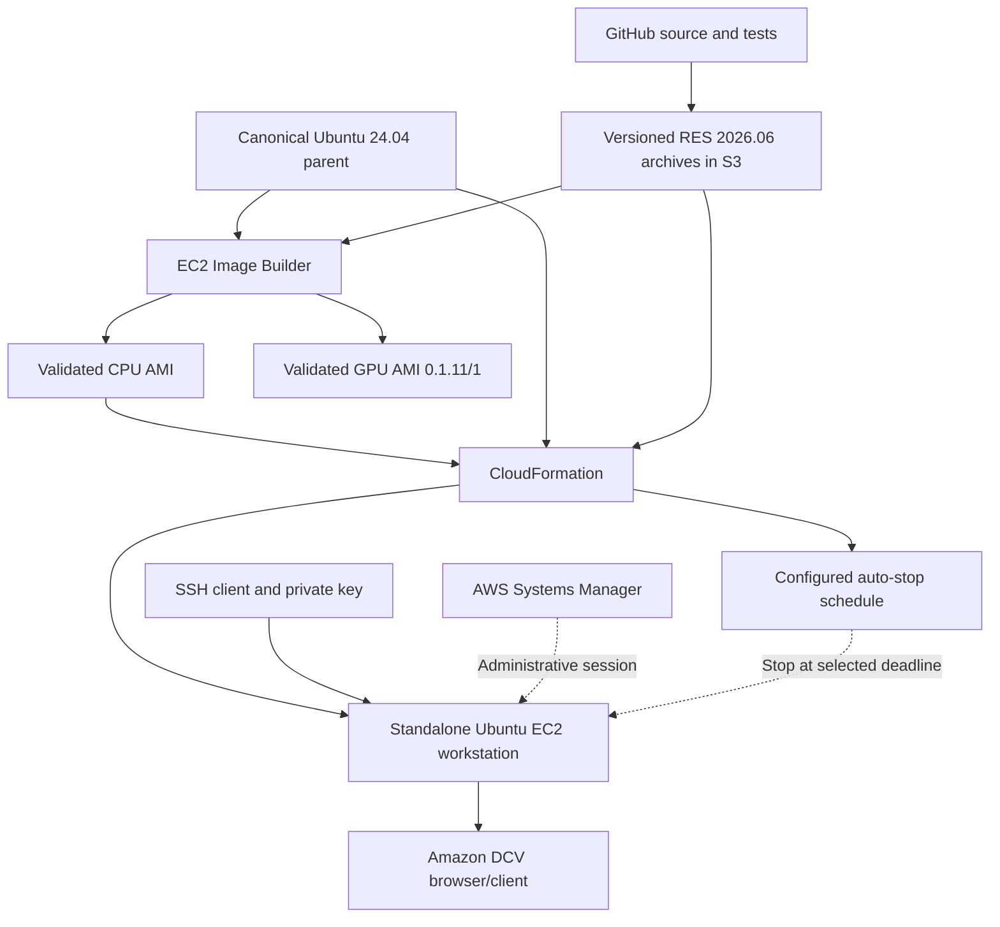

# Studio Workstation — architecture

The image records earlier image-build work. Workstation operation is separate:
the Studio CLI renders a RES-derived CloudFormation template and launches a named
EC2 instance. Current GPU launches use the Canonical base with the pinned RES
runtime installer; the lifecycle includes automatic stop and explicit destruction.

## Provisioning relationships

The GPU AMI `ami-027c98f85b155c2ac` passed Image Builder 0.1.11/1, but its **Image Builder pipeline remains disabled and points to 0.1.10**. A successful manual image build does not imply the pipeline was upgraded. The runtime downloads separate version-pinned installer and application archives after launch.

## Trust and ownership boundaries

- GitHub stores source and tests, not passwords, private keys or proprietary NVIDIA binaries.
- The live EC2 uses `StudioWorkstationSSMRole` for SSM and exact-version RES S3 access; Image Builder has its own permissions.
- DCV authenticates the local Linux `workstation` user, **not AWS IAM**. A unique password is enrolled interactively through SSM.
- Each timed workstation has a tag-conditioned Scheduler role permitted to stop its
  instance. Ordinary expiration cannot delete the stack or terminate the instance.
- New CPU/GPU desktops expose DCV TCP 8443 and SSH TCP 22 publicly by default. `--client-cidr` restricts DCV only. SSH requires the desktop owner's public key, with password/root login disabled and TCP forwarding enabled. Setup copies `/studio/config/ssh/authorized_keys` into local `~/.ssh/authorized_keys.studio` after EFS is ready; private keys stay on the client. Existing local copies survive EFS outages and refresh during setup/reboot. Publisher retains its separate security group and SSM access.
- Manual stop and expiration keep the stack and saved EBS files. Start rearms
  a verified timer and may change the public IP. Explicit `destroy NAME`
  deletes the local resources and owned timer, with absence checks.

See [Studio CLI](studio-cli.md), [lifecycle](workstation-lifecycle-visual.md), [GPU profile](gpu-workstation-profile.md), and [index](INDEX.md).
