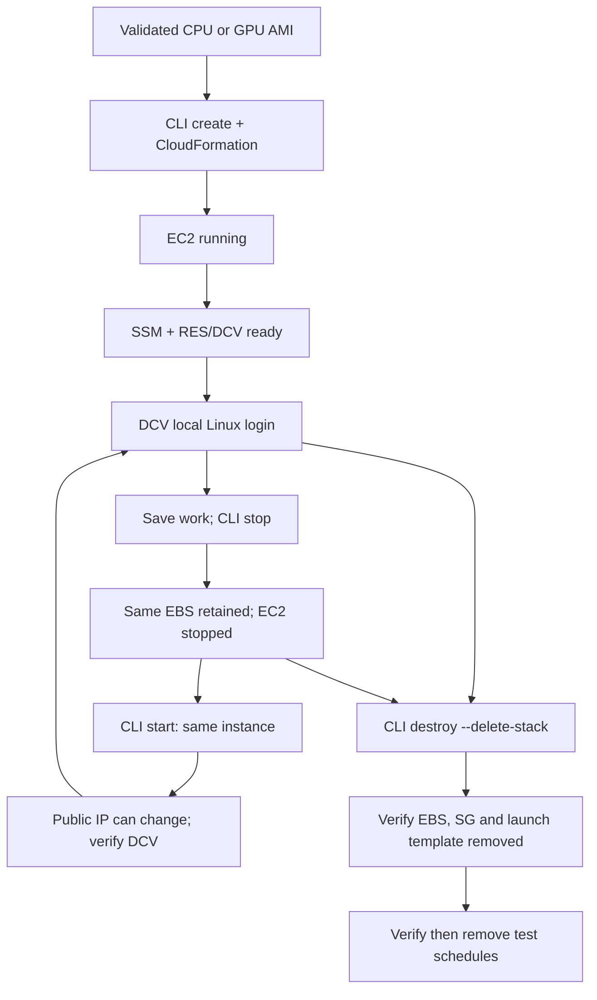

# Workstation lifecycle — validated CPU and GPU paths

A baked AMI and a running workstation are separate resources. Merged PR #65 validated **create → GPU/DCV login → stop → start → verify saved file → destroy and audit** using one scoped GPU acceptance workstation.

## Operational rules

- **Create** immediately deploys a billable stack unless `--dry-run` is supplied. There is no `--yes`, `--confirm-stack`, or `--confirm-instance`.
- **Stop** preserves the EBS-backed filesystem; EC2 compute charges stop after the instance reaches `stopped`, while storage charges continue. The GPU test observed an NVIDIA DRM warning and slow stop; the instance ultimately stopped successfully.
- **Start** may change the instance's public IPv4, as observed during GPU acceptance. Check SSM, GDM/Xorg, DCV console and GPU OpenGL rather than assuming `running` means login is ready.
- **Connect** prints the current DCV URL. DCV authenticates the local `workstation` account (set a strong password interactively via SSM). No inbound SSH is required.
- **Destroy** uses `destroy --stack NAME --delete-stack`. Retained GPU EBS (`DeleteOnTermination=false`) **may survive** stack deletion; independently inspect exact volume ID, SG, launch template and scheduled expiration actions before confirming cleanup.
- **One-shot GPU test expiration** runs through stop/start. It is not a general production stop/start service; the EBS deletion action is best-effort.

**Acceptance evidence:** CPU v0.1.3 passed prior stop/start DCV reconnection. GPU PR #65 passed exact file SHA-256 persistence, RES/T4/DCV readiness after restart and final cleanup; the user confirmed interactive DCV login before the stop/start test but not separately afterward.

See [Studio CLI](studio-cli.md), [Quick Start](../README.md#quick-start), and [Issue #46](https://github.com/vision-kwest/studio-workstation/issues/46).
