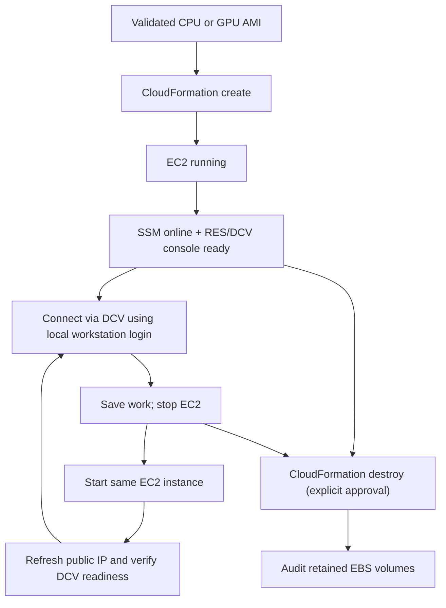

# Workstation lifecycle — visual guide

Image creation and day-to-day instance lifecycle are distinct operations.

## Operational rules

- **Stop** preserves the EBS-backed workstation and avoids running-instance compute charges; EBS charges remain.
- **Start** may assign a new public IPv4 address. Verify SSM and DCV rather than assuming EC2 running means the desktop is ready.
- **Destroy** removes stack-managed resources. With `DeleteOnTermination=false`, a root EBS volume can remain and continue to incur charges; inspect before deletion.
- The validated CPU v0.1.3 workstation successfully survived stop/start and DCV reconnection. GPU lifecycle acceptance remains pending.
- No inbound SSH is required for daily DCV use; SSM is the administrative path.

See [CLI usage](studio-cli.md) and [architecture](visual-architecture.md).
