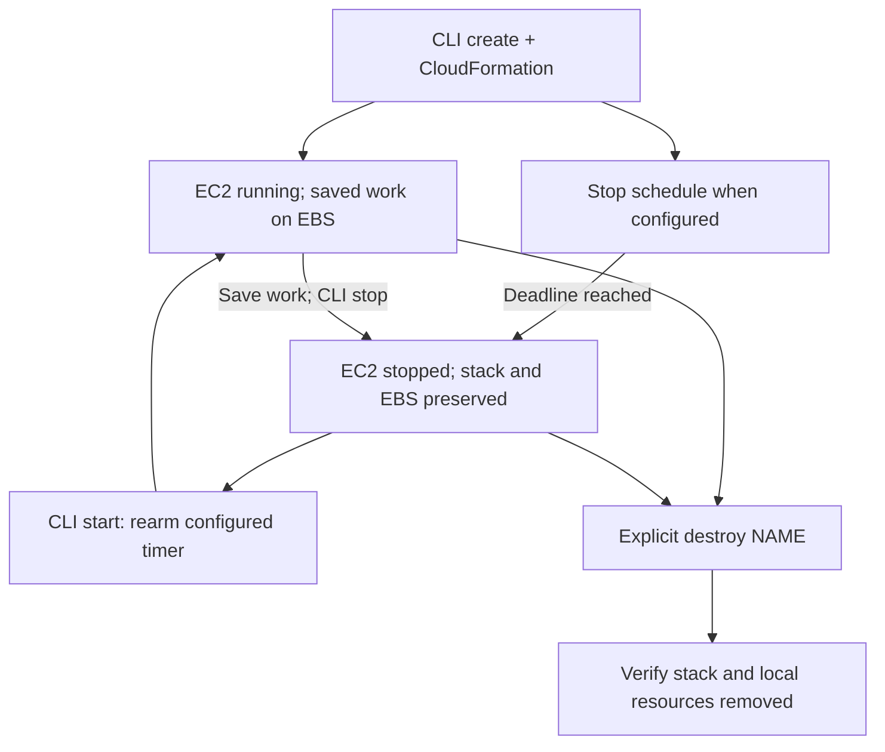

# Workstation lifecycle — automatic stop and explicit destruction

A workstation's saved local EBS files remain through manual stop and timer
expiration. A stopped workstation is reusable; explicit destroy deletes its stack
and local disks. Shared EFS and the independent hostname resources remain separate.

## Operational rules

- **Create** immediately deploys a billable stack unless `--dry-run` is supplied. There is no `--yes`, `--confirm-stack`, or `--confirm-instance`.
- **Stop and expiration** preserve saved files on EBS and the CloudFormation stack. All profiles support `--expires-in`; CPU and publisher opt in at create, while GPU defaults to 150 minutes. Compute charges end when EC2 stops; retained storage and applicable public IPv4 charges continue. RAM and instance-store data are not preserved.
- **Start** verifies a fresh configured stop deadline before starting the same instance/disk. It reuses the last create/start duration unless `--expires-in` supplies another positive `m`, `h` or `d` duration. There is no four-hour cap. Public IPv4 can change, so verify DCV readiness again.
- **Connect** prints the current DCV URL. DCV authenticates the local `workstation` account (set a strong password interactively via SSM). No inbound SSH is required.
- **Destroy** uses `destroy NAME`. CloudFormation permanently deletes the workstation, its local EBS and owned stop schedule; the CLI checks resource absence before reporting completion.
- **Existing legacy timers** are not converted by a CLI update. Review [existing workstation behavior](studio-cli.md#existing-workstations) before treating an old destructive timer as automatic stop.
- **Destructive test cleanup** is separately scoped to disposable live-test resources. It does not change ordinary workstation expiry.

**Evidence:** The Issue #68 implementation PR records validation of the new timer.
Historical CPU/GPU stop/start acceptance established EBS file persistence and DCV
readiness, but does not by itself prove delivery of the new native stop schedule.

See [Studio CLI](studio-cli.md), [Quick Start](../README.md#quick-start), and [Issue #46](https://github.com/vision-kwest/studio-workstation/issues/46).
